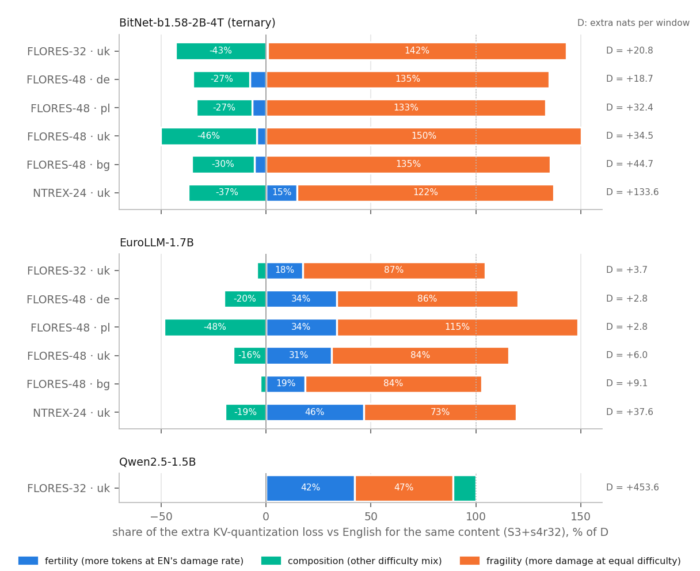

# Where does a language's extra KV-quantization loss come from? (coordinator, 2026-11-25)

Re-analysis of **existing** score files (H3 FLORES-32 and FLORES-48, H3b, H4 NTREX); no model was run. Status: **exploratory** (posed after the data).

- Script: `scripts/analyze_disparity_decomposition.py`
- Figure: `scripts/plot_disparity_decomposition.py`
- Outputs: `decomposition.csv`, `decomposition.png`, `meta.json`

## Method

On parallel text, the extra NLL per window that the KV scheme causes in language L beyond English is D = (ΣΔ_L − ΣΔ_EN)/W, in nats, for identical content.

Tokens are binned by base NLL b (the bins of the matched-difficulty analysis), where s(k) is the token share and m(k) the mean damage of bin k. Then **exactly**:

| Term | Formula | Meaning |
|---|---|---|
| fertility | (N_L − N_EN) · d̄_EN | L's extra tokens, charged at English's average damage |
| composition | N_L · Σ (s_L − s_EN)(m_L + m_EN)/2 | L's tokens fall into a different difficulty mix |
| fragility | N_L · Σ (m_L − m_EN)(s_L + s_EN)/2 | L's tokens lose more at equal difficulty |

The midpoint (Kitagawa) split does not depend on which language is the reference. The script asserts that the three terms sum to D.

Variant `lt4` first drops tokens with b ≥ 4 in both languages: in that high-surprise tail, quantization noise lowers NLL.

The bootstrap resamples windows, paired across languages: 10,000 resamples, seed 0, percentile 95% CIs.

## Results (S3+s4r32, all tokens; % of D)

| Corpus · lang | Model | D (nats / window) | Fertility | Composition | Fragility |
|---|---|---|---|---|---|
| FLORES-32 · uk | BitNet | +20.9 | +0.2 [−0.8, +1.2] (1%) | −9.0 (−43%) | **+29.7 [+22.8, +37.0] (142%)** |
| FLORES-48 · de / pl / uk / bg | BitNet | +18.7 / +32.4 / +34.5 / +44.7 | −8 / −7 / −4 / −6% | −27 / −27 / −46 / −30% | **135 / 133 / 150 / 135%** |
| NTREX-24 · uk | BitNet | +133.6 | +19.8 (15%) | −49.5 (−37%) | **+163.3 [+144.3, +184.8] (122%)** |
| FLORES-32 · uk | EuroLLM | +3.7 | +0.6 (18%) | −0.2 (−4%) | +3.2 [−0.1, +6.5] (87%) |
| FLORES-48 · de / pl / uk / bg | EuroLLM | +2.9 / +2.8 / +6.0 / +9.1 | **34 / 34 / 31 / 19%** | −20 / −48 / −16 / −3% | 86 / 115 / 84 / 84% |
| NTREX-24 · uk | EuroLLM | +37.6 | **+17.5 [+14.8, +20.3] (46%)** | −7.3 (−19%) | +27.4 [+18.6, +36.4] (73%) |
| FLORES-32 · uk | Qwen | +453.6 | **+191.8 (42%)** | +49.3 (11%) | +212.5 (47%) |

The `lt4` variant leaves the picture unchanged for BitNet: fragility is 97–103% of D in every language and corpus, and fertility and composition are ≈ 0. For EuroLLM, fertility is 37–54% of D, fragility 73–93%, composition −14 to −38%.

**Character window (S3+s4c120, FLORES-48):**
- EuroLLM uk: the fragility term falls from +5.05 [+2.91, +7.22] to **+1.31 [−0.88, +3.44]** and the fertility term stays (+2.17), so what remains is mostly "more tokens".
- BitNet uk: fragility falls only from +51.9 to +43.4 and still makes up 155% of D.
- NTREX r = 128 shrinks D in both models but leaves the shares unchanged: BitNet 122% fragility; EuroLLM 51% fertility, 74% fragility.

## Reading

1. **BitNet: practically all of the language gap is per-token fragility.**
   - This holds in every language (de, pl, uk, bg), on both corpora, and on tokens of any difficulty (lt4: ~100%).
   - Fertility contributes nothing: many of BitNet's extra tokens are hard ones (b ≥ 4), where the damage is small or negative. For Ukrainian this is almost all of them: among b < 4 tokens φ falls from 1.64 to 0.96.
   - So "more tokens per content" is not why BitNet's non-English text suffers.
2. **EuroLLM: about a third to a half is plain fertility.** The rest is fragility that, for Ukrainian, a character-defined recent window removes. This matches H3b, where C = 120 cut EuroLLM's UK R by 71%.
3. **Qwen** sits in between: 42% fertility, 47% fragility.
4. **Composition is negative for BitNet and EuroLLM.** Their non-English tokens sit in difficulty bins that lose less on average, which partly offsets the other terms; for Qwen it is slightly positive (+11%). Reporting only R or only the matched ratio hides this offset.
5. **For the paper:** the decomposition answers "fertility or fragility?" **within** each model, per language, without a cross-language regression.
   - The 11-language regression (H2) remains the way to ask **which language property predicts the fragility**.
   - The H4 control remains the way to ask **whether ternary weights do**.

## Caveats

- Exploratory: posed after seeing the H3/H4 data.
- The split between composition and fragility depends on the binning (7 bins of base NLL). The fertility term does not.
- FLORES-48 is labelled `flores5` in the CSV, following the H3 naming.
