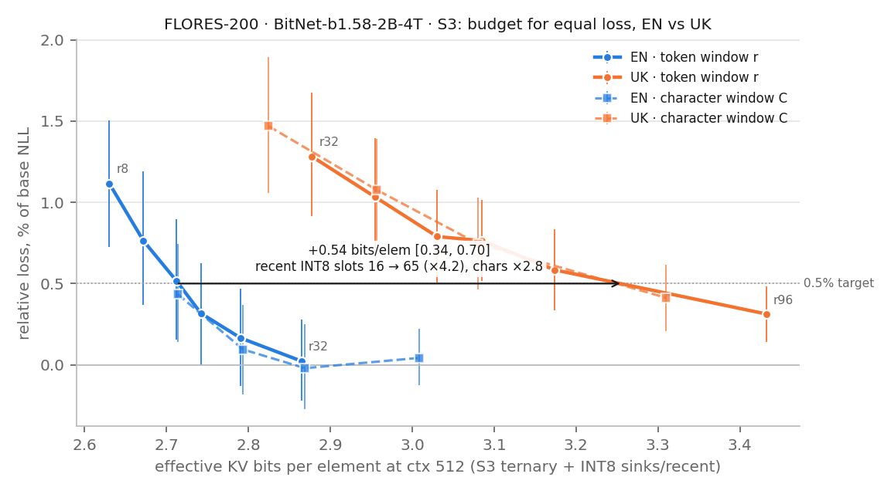

# Iso-loss KV budget: how much more cache does Ukrainian need? (T51 preview)

Coordinator, 2026-11-25. Re-analysis of the **existing** H1 score files (`results/2026-11-24-b_agent2/H1/scores`): FLORES-200, 32 paired EN/UK windows, BitNet-b1.58-2B-4T golden fp32, S3 = Hadamard + ternary g32 + 4 sinks + INT8 recent window. No model was run.

- Script: `scripts/analyze_iso_loss_bits.py`
- Figure: `scripts/plot_iso_loss_bits.py`
- Outputs: `iso_loss_bits.csv`, `iso_loss_curves.csv`, `iso_loss_bits.png`, `meta.json` (input sha256)

**Status: exploratory (post hoc).** The question was posed after H1 had been run, so nothing here is a pre-registered test.

## Question and method

How many INT8 recent slots, or bits per KV element, does UK need to reach the **same relative loss** as EN?

- **Relative loss.** `rel_L = mean_w(Δ_w / B_w)`, the same convention as `rel` and `R` in the H1, H3 and H4 reports. The script asserts agreement with H1's `char_window_coverage.csv` to 1e-6.
- **Budget axis.** `bits_at_512` from H1, built from `r_eff` (mean active INT8 recent slots) and the kv_ptq constants: 8.125 b/elem for INT8 and 2.5 for S3. It is standardized to ctx = 512.
- **Policy families.** Two curves per language:
  - token window r: EN r = 8–32, UK r = 32–96;
  - character window C = 80–240.
- **Targets.** t ∈ {1.0, 0.75, 0.5}% relative loss. The budget is the first crossing of `rel_L` below t, interpolated linearly between adjacent policies. `tax = UK − EN`.
- **Bootstrap.** Paired window bootstrap (EN, UK and all policies resampled jointly), 10,000 reps, seed 0.
  - A resample whose curve never reaches t is **censored** and is excluded from the CI; its share is reported.
  - A curve already below t at its cheapest policy returns that policy's budget as an upper bound (**left**).

## Results

| Family | Target | EN bits@512 | UK bits@512 | Tax, bits/elem [95% CI] | INT8 slots EN → UK | Covered chars EN → UK |
|---|---|---|---|---|---|---|
| token r | 1.0% | 2.64 | 2.97 | **+0.32 [+0.22, +0.43]** | 9 → 38 (×4.2) | 46 → 123 (×2.7) |
| token r | 0.75% | 2.67 | 3.09 | **+0.42 [+0.26, +0.56]** | 12 → 50 (×4.2) | 60 → 164 (×2.7) |
| token r | 0.5% | 2.72 | 3.25 | **+0.54 [+0.34, +0.70]** | 16 → 65 (×4.2) | 80 → 221 (×2.8) |
| char C | 1.0% | ≤ 2.71 (left) | 2.99 | ≥ +0.27 [+0.14, +0.38] | ≤ 15 → 40 | ≤ 77 → 128 |
| char C | 0.75% | ≤ 2.71 (left) | 3.08 | ≥ +0.37 [+0.25, +0.51] | ≤ 15 → 49 | ≤ 77 → 158 |
| char C | 0.5% | ≤ 2.71 (left) | 3.25 | ≥ +0.54 [+0.34, +0.59] | ≤ 15 → 64 | ≤ 77 → 218 |

Censoring:
- In the token family, 2% of UK resamples are censored at 0.5%; none elsewhere.
- In the char family, 20% of UK resamples are censored at 0.5%, so that CI is optimistic.
- The char-family EN curve is already below 1.0% and 0.75% at C = 80. There the EN budget is an upper bound and the tax a lower bound.

## Reading

1. **UK needs about 4× as many full-precision recent slots for the same loss.** This holds at every target: ×4.2 in tokens.
   - Fertility alone would predict ×1.6–1.7, since UK uses 1.6–1.7× more tokens per content on these windows.
   - Even counted in characters, UK needs ×2.7–2.8 more covered text.
   - So equal text coverage is not enough. This agrees with H1's "partial" verdict and with the matched-difficulty result: at equal token difficulty, BitNet's UK tokens are 5–11× more fragile.
2. **A character window is a language-dependent INT8 allocation, not a better quality-per-bit.**
   - On the bits axis the UK char-C and token-r curves coincide: C = 160 ≈ r = 54, and C = 240 falls between r = 64 and r = 96.
   - The char window helps because it hands the high-fertility language more INT8 slots automatically.
   - The paper can phrase this as "budget must follow the language", whatever the mechanism.
3. **The tax in bits depends on context length; the slot ratio is the transferable quantity.**
   - If the needed r were fixed, the bits tax would shrink as 1/ctx: (r_UK − r_EN) · 5.625 / ctx, i.e. +0.54 at 512 and ≈ +0.07 at 4096.
   - It is not fixed. On NTREX at ctx 1024, r = 128 still leaves R = +0.86 pp, so the needed window grows with context. No extrapolation beyond the measured lengths.

## Cross-check on NTREX (ctx up to 1024), both models

`scripts/analyze_ntrex_slot_ratio.py` → `ntrex_slot_ratio.csv`. Only two window sizes exist there (r = 32 and r = 128), so the method is coarser:
- Take UK's loss at r = 128 as the target.
- Find the EN window with the same loss on the chord between r = 32 and r = 128. The chord over-estimates the EN window, so the ratio is conservative.
- `rel` is pooled (ΣΔ/ΣB), the H4 convention; it reproduces the H4 numbers.

| Model | EN r32 / r128 | UK r32 / r128 | EN window ≈ UK r128 | Slot ratio [95% CI] |
|---|---|---|---|---|
| BitNet | 1.90% / 1.02% | 3.41% / 1.85% | r ≈ 38 | **3.35 [1.70, ≥ 4]** (38% of resamples: EN needs ≤ 32) |
| EuroLLM | 2.51% / 1.11% | 3.90% / 1.65% | r ≈ 91 | **1.40 [1.17, 1.79]** |
| BitNet − EuroLLM | | | | **+1.95 [+0.35, +2.75]**, P(≤ 0) = 0.001 |

Same picture as on FLORES (×4.2 for BitNet), and the same split between models as in the matched-difficulty analysis (BitNet 4.8 vs EuroLLM 1.5 on NTREX). The model that knows Ukrainian worse needs several times more INT8 slots for Ukrainian; the model that knows it well needs only ~1.4×, which is still about EuroLLM's own fertility gap (EN 261 vs UK 372 tokens per FLORES window, ×1.4).

## Caveats

- FLORES part: one model (BitNet, golden) and one corpus. NTREX part: two models, but only two window sizes. The windows are short: 237 EN and 388 UK tokens on average.
- **Conventions differ between reports:** H1 uses the per-window mean of ratios for `rel`, H3 and H4 the pooled ratio. Both are used here, each matching its source; on FLORES windows of similar length the two differ by < 0.05 pp.
- `bits_at_512` standardizes the INT8 share to ctx 512 exactly as in H1. Actual-length bits (`bits_win`) are in `iso_loss_curves.csv`.
- Linear interpolation between at most 6 policies per curve; the error bars of adjacent policies overlap.

## Hand-off to H3 (T51)

- Add the V-bit family as another set of curves: S3 with V INT4 and with V 2-bit.
- Report the same iso-loss budget for it. The question is whether giving V more bits closes the UK tax more cheaply per bit than more INT8 slots do.
- Extend `FAMILIES` in `scripts/analyze_iso_loss_bits.py` rather than writing a new script.
