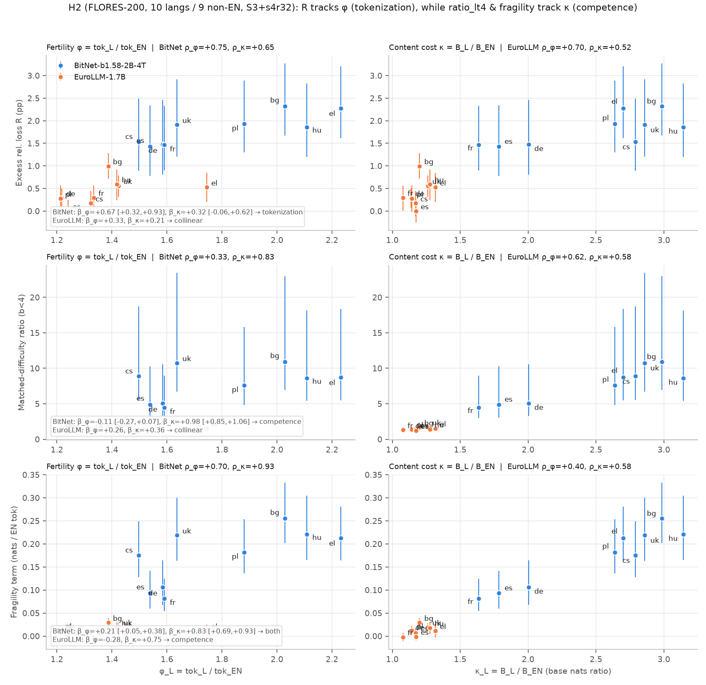

# H2 (T50 Part 2): Fertility vs Competence Across 11 Parallel FLORES-200 Languages

## Plan

### Research Question
On fixed parallel content where both tokenizer fertility (`φ_L`) and model content cost (`κ_L`, inverse competence) vary across languages, which factor drives KV-cache quantization disparity (`S3+s4r32`) in `BitNet-b1.58-2B-4T` (`golden_bitnet.py`) and `EuroLLM-1.7B`?

### Data & Window Definition (`N = 48`)
- **Corpus:** `FLORES-200 devtest` (`~/tenzo-refs/datasets/flores200/flores200_dataset.tar.gz`).
- **Windows:** Exact `N = 48` windows from `results/2026-11-24-b_agent2/H3/flores5_meta.json` using `windows[i].sent_start .. windows[i].sent_end` (sentences `209..633`), **without** re-running the greedy length packer so boundaries remain fixed and all 5 prior languages are reused without recomputation.
- **11 Languages:**
  - **5 reused from `2026-11-24-b` H3 (`flores5`):** `en` (`eng_Latn`), `de` (`deu_Latn`), `pl` (`pol_Latn`), `uk` (`ukr_Cyrl`), `bg` (`bul_Cyrl`).
  - **6 new:**
    - `fr` (`fra_Latn`), `es` (`spa_Latn`) — high-resource Latin
    - `cs` (`ces_Latn`), `hu` (`hun_Latn`), `fi` (`fin_Latn`) — lower-resource Latin (`hu`, `fi` agglutinative)
    - `el` (`ell_Grek`) — non-Latin Greek script
- **Invariants verified prior to evaluation:**
  - Reconstructed `.ids` for `{en,de,pl,uk,bg} × {bitnet,eurollm}` MUST be byte-for-byte identical to `results/2026-11-24-b_agent2/H3/flores5_{model}_{lang}.ids`.
  - Context limit `ctx = 1024`; any window with `> 1023` scored tokens is dropped for that language and reported explicitly (`max_scored_tokens <= 605` expected -> `0` dropped).
  - `0` 32-gram overlap against calibration sets, prior non-FLORES5 eval windows, and within-language self-windows. No raw FLORES text committed.

### Models, Schemes & Execution Protocol
- **Models (`D4`):** `BitNet-b1.58-2B-4T` (`golden_bitnet.py`, `MemoryMax=4G`) and `EuroLLM-1.7B` (`MemoryMax=6G`), executed sequentially under `systemd-run --user --scope -p MemoryMax=... -p MemorySwapMax=0 -- nice -n 19 ionice -c3` (verifying `MemAvailable >= MemoryMax + 2 GB` before each run).
- **Schemes:** baseline (`fp32` for BitNet, `fp` for EuroLLM) and `S3+s4r32` (`tenzo_int8` omitted as near-zero control; `Qwen2.5-1.5B` excluded per `D4`).
- **Parity check:** B=1 logit/log-prob parity on first window (`< 1e-6` BitNet, `< 1e-5` EuroLLM).
- **Staged run order (`D5` hard cutoff: start nothing after `08:30` or finishing past `08:45`):**
  1. **Stage 1 (`fr, cs, hu, el`):** BitNet (`fr,cs,hu,el`), then EuroLLM-1.7B (`fr,cs,hu,el`). Yields `8` non-EN languages (`>= 6` minimum for OLS verdict).
  2. **Stage 2 (`es`, then `fi`, clock-gated):** each language run sequentially across BitNet then EuroLLM ONLY if estimated finish is `<= 08:45` and start is `< 08:30`, ensuring no half-model language enters `flores11`.

### Metrics & Statistical Analysis
- **Statistical convention:** All pooled `ΣΔ/ΣB`; `10,000` paired window bootstrap samples (`seed = 0`).
- **Predictors & Metrics (per language `L` and model):**
  - `φ_L = tok_L / tok_EN` (tokenizer fertility)
  - `κ_L = B_L / B_EN` (content cost in nats / inverse model competence)
  - Matched-difficulty metrics via `scripts/analyze_matched_difficulty.py` (after adding `"flores11"` to `SETS`)
  - Exact 3-way disparity decomposition (`fertility`, `composition`, `fragility`) via `scripts/analyze_disparity_decomposition.py` (after adding `"flores11"` to `SETS`)
- **Primary & Secondary Regressions (`scripts/analyze_fertility_vs_competence.py --set flores11` unchanged):**
  - **Primary:** `--response R` (`R_L` excess relative loss vs EN, pp)
  - **Secondary:** `--response ratio_lt4` (matched-difficulty ratio on `b < 4`)
  - **Third:** `--response fragility` (decomposition fragility term in nats per EN token)
  - Per model, fits OLS `y_L ~ log φ_L + log κ_L` across non-EN languages with standardized coefficients, `95%` paired window bootstrap CIs, `VIF`, and Spearman rank correlations `ρ`.

### Decision Rule (Pre-registered)
Applied separately per model and response (`N_non_en < 6` -> `too_few_languages`):
- **`tokenization`:** `95% CI(β_logφ) > 0` AND `0 ∈ 95% CI(β_logκ)` (with `VIF <= 5`)
- **`competence`:** `95% CI(β_logκ) > 0` AND `0 ∈ 95% CI(β_logφ)` (with `VIF <= 5`)
- **`both`:** both `95% CI(β_logφ) > 0` AND `95% CI(β_logκ) > 0` (with `VIF <= 5`)
- **`collinear`:** `VIF > 5` OR both CIs include `0`
- All three responses (`R`, `ratio_lt4`, `fragility`) will be reported transparently regardless of whether they agree.

---

## Results (`10` Languages / `9` Non-EN Completed on Both Models, `N = 48`)

- **Coverage achieved under `D5`:** `10` FLORES-200 languages (`en` + `9` non-EN: `de, pl, uk, bg, fr, cs, hu, el, es`) completed cleanly on both models (`0` dropped windows, max scored tokens `605` BitNet / `523` EuroLLM; `0` 32-gram overlap; `B=1` parity `0.000e+00` BitNet, `<= 5.007e-06 < 1e-5` EuroLLM). The 11th candidate (`fi`) was deferred to the next night per the `D5` `08:30`/`08:45` cutoff. Passing `9 >= 6` non-EN languages yielded low predictor collinearity (`corr(log φ, log κ) = +0.59, VIF = 1.5` BitNet; `corr = +0.77, VIF = 2.4` EuroLLM).
- **Convention:** All `rel` and `R` metrics use pooled `ΣΔ / ΣB` (`10,000` paired window bootstrap, `seed = 0`).

### 1. Standardized OLS Regression (`y_L ~ log φ_L + log κ_L`, `N_non_en = 9`)

| Model | Response `y_L` | `β_logφ` [95% CI] | `β_logκ` [95% CI] | `corr(log φ, log κ)` | `VIF` | Spearman `ρ(y, φ)` | Spearman `ρ(y, κ)` | Verdict (pre-registered) |
|---|---|---:|---:|---:|---:|---:|---:|---|
| `BitNet-2B` | **`R` (pp, primary)** | **`+0.67` [`+0.32`, `+0.93`]** | `+0.32` [`-0.06`, `+0.62`] | `+0.59` | `1.5` | `+0.75` | `+0.65` | **`tokenization`** |
| `BitNet-2B` | **`ratio_lt4` (`b<4`)** | `-0.11` [`-0.27`, `+0.07`] | **`+0.98` [`+0.85`, `+1.06`]** | `+0.59` | `1.5` | `+0.33` | `+0.83` | **`competence`** |
| `BitNet-2B` | **`fragility` (nats/EN tok)** | **`+0.21` [`+0.05`, `+0.38`]** | **`+0.83` [`+0.69`, `+0.93`]** | `+0.59` | `1.5` | `+0.70` | `+0.93` | **`both`** (`κ` ~4× larger) |
| `EuroLLM-1.7B` | **`R` (pp, primary)** | `+0.33` [`-0.09`, `+0.75`] | `+0.21` [`-0.21`, `+0.56`] | `+0.77` | `2.4` | `+0.70` | `+0.52` | **`collinear`** (both CIs ∋ 0) |
| `EuroLLM-1.7B` | **`ratio_lt4` (`b<4`)** | `+0.26` [`-0.29`, `+0.80`] | `+0.36` [`-0.18`, `+0.74`] | `+0.77` | `2.4` | `+0.62` | `+0.58` | **`collinear`** (both CIs ∋ 0) |
| `EuroLLM-1.7B` | **`fragility` (nats/EN tok)** | `-0.28` [`-0.68`, `+0.22`] | **`+0.75` [`+0.38`, `+0.97`]** | `+0.77` | `2.4` | `+0.40` | `+0.58` | **`competence`** |

### 2. Per-Language Metrics & Exact Kitagawa Decomposition (`S3+s4r32`, `N = 48`)

#### BitNet-b1.58-2B-4T (`EN` baseline tokens `237.3/win`)

| Lang | `φ_L` | `κ_L` | `R_L` (pp) [95% CI] | `ratio_lt4` (`b<4`) [95% CI] | `D` (nats/win) | Fertility % | Comp. % | Fragility % | `fragility` (nats/EN tok) [95% CI] |
|---|---:|---:|---:|---:|---:|---:|---:|---:|---:|
| `fr` | `1.59` | `1.64` | `+1.47` [`+0.90`, `+2.33`] | `4.49×` [`2.98`, `8.94`] | `+15.62` | `-9%` | `-15%` | `+124%` | `+0.082` [`+0.054`, `+0.124`] |
| `es` | `1.54` | `1.79` | `+1.43` [`+0.78`, `+2.34`] | `4.90×` [`3.05`, `10.26`] | `+16.32` | `-8%` | `-27%` | `+135%` | `+0.093` [`+0.059`, `+0.142`] |
| `de` | `1.58` | `2.01` | `+1.48` [`+0.81`, `+2.46`] | `5.07×` [`3.26`, `10.57`] | `+18.72` | `-8%` | `-27%` | `+135%` | `+0.106` [`+0.068`, `+0.164`] |
| `pl` | `1.88` | `2.64` | `+1.93` [`+1.30`, `+2.89`] | `7.58×` [`4.83`, `15.83`] | `+32.43` | `-7%` | `-27%` | `+133%` | `+0.182` [`+0.136`, `+0.253`] |
| `el` | `2.23` | `2.70` | `+2.27` [`+1.61`, `+3.21`] | `8.70×` [`5.49`, `18.35`] | `+39.80` | `-7%` | `-19%` | `+127%` | `+0.212` [`+0.164`, `+0.281`] |
| `cs` | `1.50` | `2.79` | `+1.53` [`+0.89`, `+2.49`] | `8.88×` [`5.52`, `18.75`] | `+26.29` | `-5%` | `-54%` | `+158%` | `+0.175` [`+0.128`, `+0.249`] |
| `uk` | `1.64` | `2.86` | `+1.91` [`+1.21`, `+2.92`] | `10.76×` [`6.73`, `23.43`] | `+34.55` | `-4%` | `-46%` | `+150%` | `+0.219` [`+0.163`, `+0.300`] |
| `bg` | `2.03` | `2.98` | `+2.32` [`+1.67`, `+3.27`] | `10.92×` [`6.96`, `23.00`] | `+44.71` | `-6%` | `-30%` | `+135%` | `+0.255` [`+0.201`, `+0.333`] |
| `hu` | `2.11` | `3.14` | `+1.86` [`+1.20`, `+2.83`] | `8.62×` [`5.39`, `18.15`] | `+36.66` | `-7%` | `-36%` | `+143%` | `+0.221` [`+0.165`, `+0.305`] |

#### EuroLLM-1.7B (`EN` baseline tokens `261.1/win`)

| Lang | `φ_L` | `κ_L` | `R_L` (pp) [95% CI] | `ratio_lt4` (`b<4`) [95% CI] | `D` (nats/win) | Fertility % | Comp. % | Fragility % | `fragility` (nats/EN tok) [95% CI] |
|---|---:|---:|---:|---:|---:|---:|---:|---:|---:|
| `fr` | `1.33` | `1.08` | `+0.30` [`+0.01`, `+0.56`] | `1.31×` [`1.09`, `1.59`] | `+2.53` | `+58%` | `+62%` | `-20%` | `-0.002` [`-0.012`, `+0.007`] |
| `de` | `1.22` | `1.14` | `+0.29` [`+0.07`, `+0.50`] | `1.31×` [`1.12`, `1.55`] | `+2.85` | `+34%` | `-20%` | `+86%` | `+0.009` [`+0.002`, `+0.016`] |
| `pl` | `1.21` | `1.14` | `+0.27` [`-0.02`, `+0.56`] | `1.42×` [`1.19`, `1.71`] | `+2.78` | `+34%` | `-48%` | `+115%` | `+0.012` [`+0.003`, `+0.022`] |
| `cs` | `1.32` | `1.17` | `+0.17` [`-0.11`, `+0.45`] | `1.38×` [`1.12`, `1.68`] | `+2.13` | `+67%` | `-48%` | `+82%` | `+0.007` [`-0.004`, `+0.016`] |
| `es` | `1.24` | `1.18` | `-0.00` [`-0.25`, `+0.24`] | `1.21×` [`1.02`, `1.45`] | `+0.75` | `+140%` | `-4%` | `-36%` | `-0.001` [`-0.010`, `+0.007`] |
| `bg` | `1.39` | `1.20` | `+1.00` [`+0.72`, `+1.28`] | `1.68×` [`1.45`, `1.97`] | `+9.09` | `+19%` | `-3%` | `+84%` | `+0.029` [`+0.020`, `+0.039`] |
| `uk` | `1.42` | `1.26` | `+0.56` [`+0.32`, `+0.79`] | `1.71×` [`1.45`, `2.03`] | `+5.98` | `+31%` | `-16%` | `+84%` | `+0.019` [`+0.011`, `+0.027`] |
| `hu` | `1.42` | `1.28` | `+0.59` [`+0.25`, `+0.92`] | `1.40×` [`1.13`, `1.72`] | `+6.43` | `+29%` | `-2%` | `+73%` | `+0.018` [`+0.004`, `+0.030`] |
| `el` | `1.74` | `1.32` | `+0.52` [`+0.21`, `+0.85`] | `1.54×` [`1.26`, `1.88`] | `+6.12` | `+54%` | `-3%` | `+49%` | `+0.011` [`-0.003`, `+0.025`] |

## Decision & Interpretation

- **BitNet (`VIF = 1.5`, genuinely separated across `fr/es/de` vs `cs/uk/hu` vs `el/bg`):** The two pre-registered families of responses cleanly separate the two mechanisms rather than contradicting each other:
  1. On **excess relative NLL loss `R`** (which divides damage by `B_L = κ_L · B_EN`), **`tokenization`** (`β_logφ = +0.67 [+0.32, +0.93]`, `β_logκ = +0.32 [-0.06, +0.62]`) is the primary predictor: high fertility shrinks the physical text covered by the fixed `32`-token INT8 recent window (e.g., `el` `φ=2.23`, `R=+2.27 pp` vs `cs` `φ=1.50`, `R=+1.53 pp` despite similar `κ=2.70` vs `2.79`).
  2. On **matched-difficulty ratio `ratio_lt4`** (`b < 4`), **`competence`** dominates cleanly (`β_logκ = +0.98 [+0.85, +1.06]`, `β_logφ = -0.11 [-0.27, +0.07]`): weak-competence languages (`uk 10.8×`, `bg 10.9×`, `cs 8.9×`, `el 8.7×`, `hu 8.6×`) lose ~2× more per equal-difficulty token than `fr/es/de` (`4.5–5.1×`).
  3. On **absolute content-normalized fragility `fragility`** (nats per EN token), **`both`** contribute (`β_logκ = +0.83 [+0.69, +0.93]`, `β_logφ = +0.21 [+0.05, +0.38]`), with `κ` ~4× stronger than `φ`, and `fragility` accounts for `124–158%` of total `D` across all `9` languages (`fertility` is `-4%..-9%`).
- **EuroLLM-1.7B (`VIF = 2.4`):** Because EuroLLM knows all `9` languages relatively well (`κ ∈ [1.08, 1.32]`) with small disparity (`|R| <= 1.00 pp`, `fr/es` `fragility` CI covering 0), `R` and `ratio_lt4` classify as **`collinear`** (both coefficient CIs span `0` with `N_non_en = 9`), whereas `fragility` isolates **`competence`** (`β_logκ = +0.75 [+0.38, +0.97]`). Note how in high-resource Romance `fr` (`+58%` fert, `-20%` frag) and `es` (`+140%` fert, `-36%` frag) EuroLLM exhibits essentially zero excess fragility.
- **Sample-size caveat:** With `9` non-EN languages per model, regressions remain low-`N` observational fits across typologically skewed European languages; conclusions apply strictly to these `10` FLORES languages and two `~2B` models (`H4` SmolLM2 run next night is still required to test ternary weights vs competence).

## Reproducibility
- Prep: `python3 scripts/prepare_h2_flores11.py` -> `results/2026-11-26_agent2/H2/flores11_meta.json` (`0` dropped, `0` 32-gram overlap, `10/10` old5 `.ids` byte-identical)
- Eval: `scripts/run_h2_flores11.py --model {bitnet,eurollm} --langs fr,cs,hu,el` then `--langs es` under `MemoryMax=4G/6G`
- Analyses: `scripts/analyze_matched_difficulty.py`, `scripts/analyze_disparity_decomposition.py`, `scripts/analyze_fertility_vs_competence.py --set flores11 --response {R,ratio_lt4,fragility}`, `scripts/plot_h2_flores11.py`

